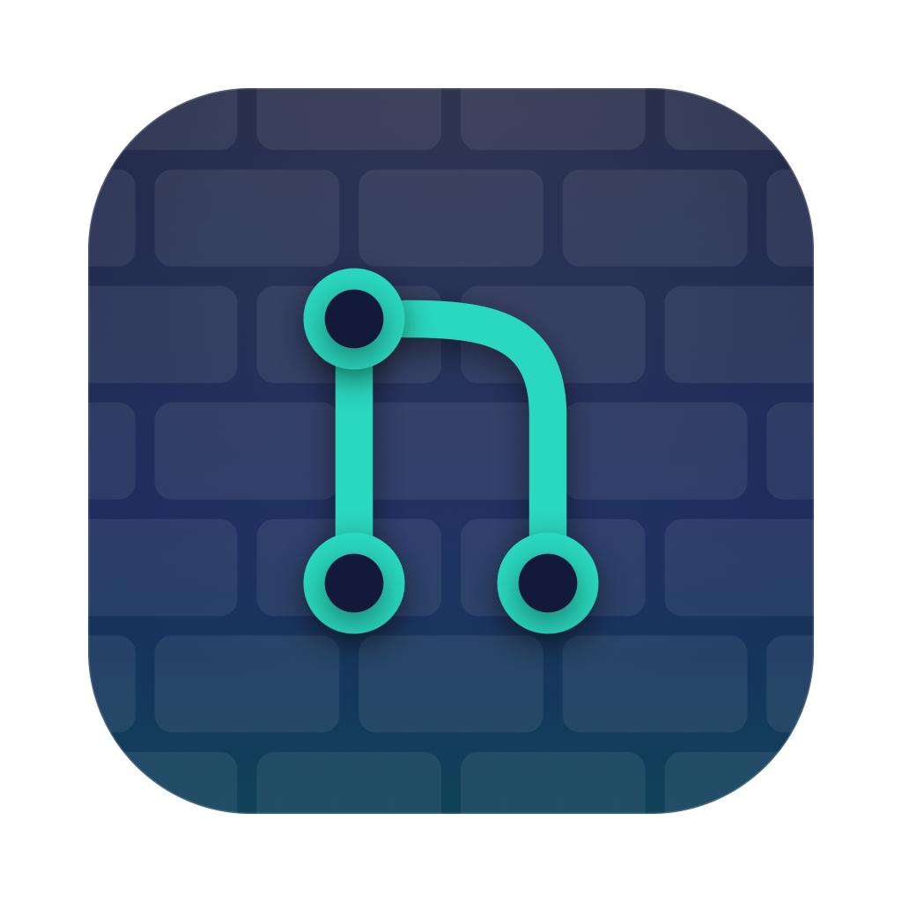
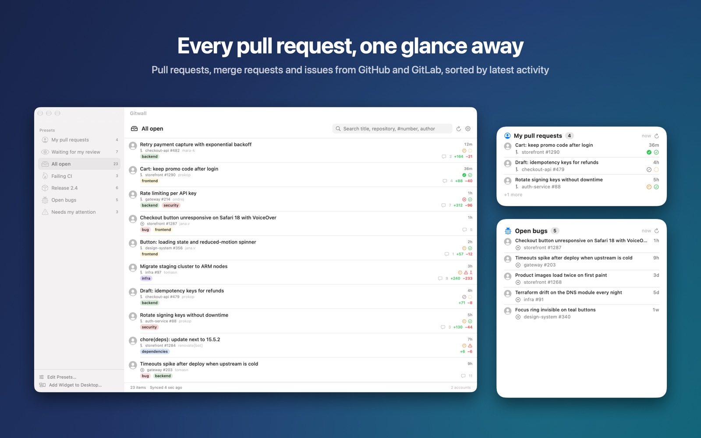
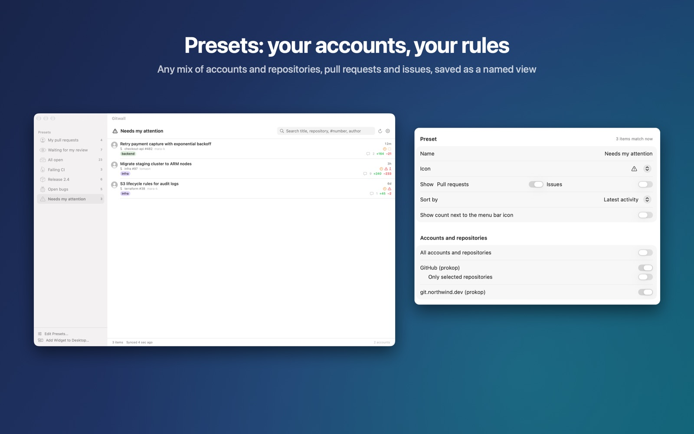
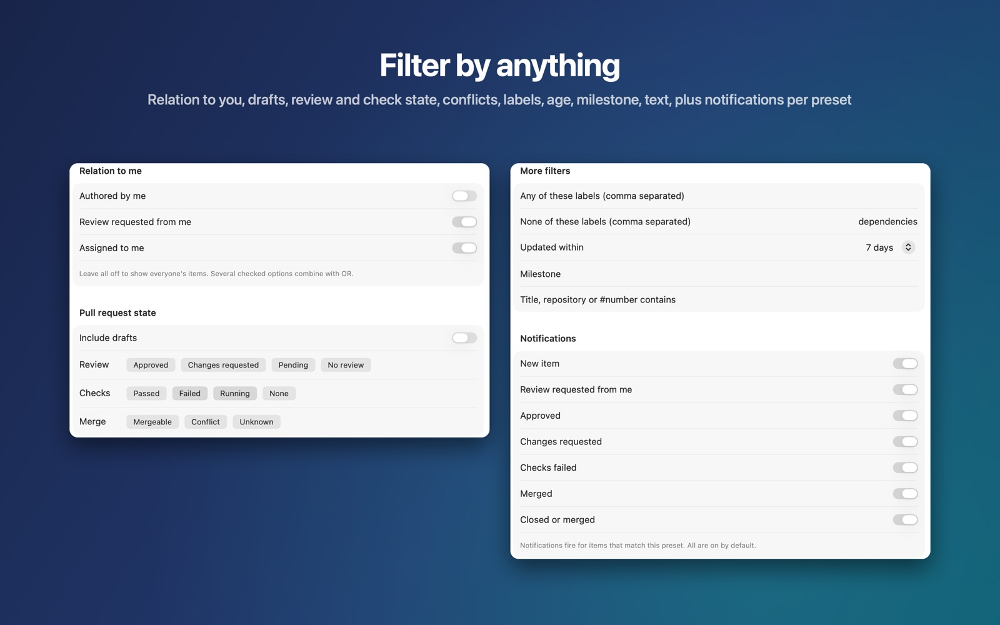
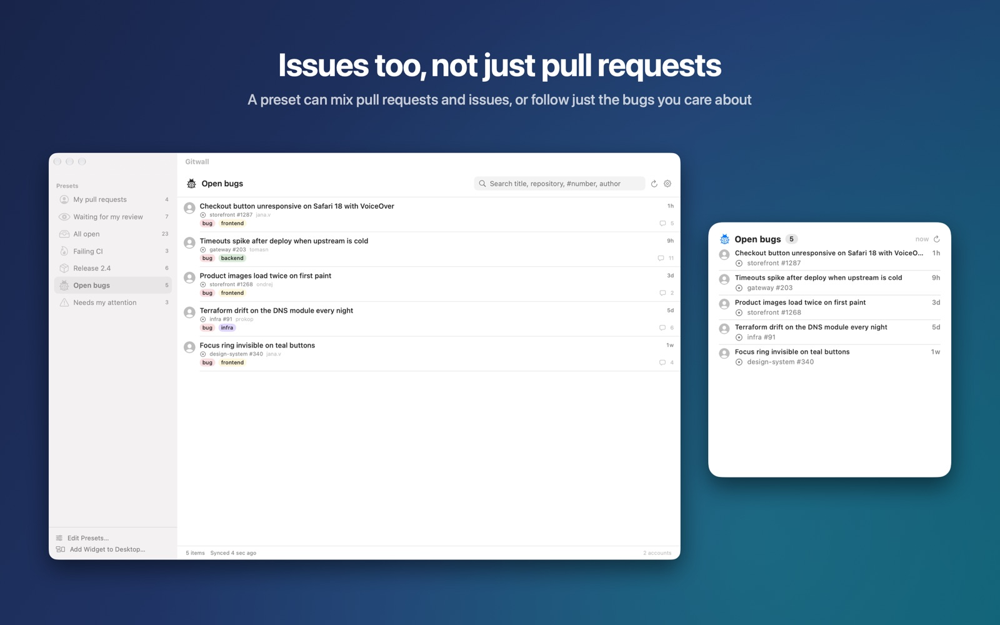
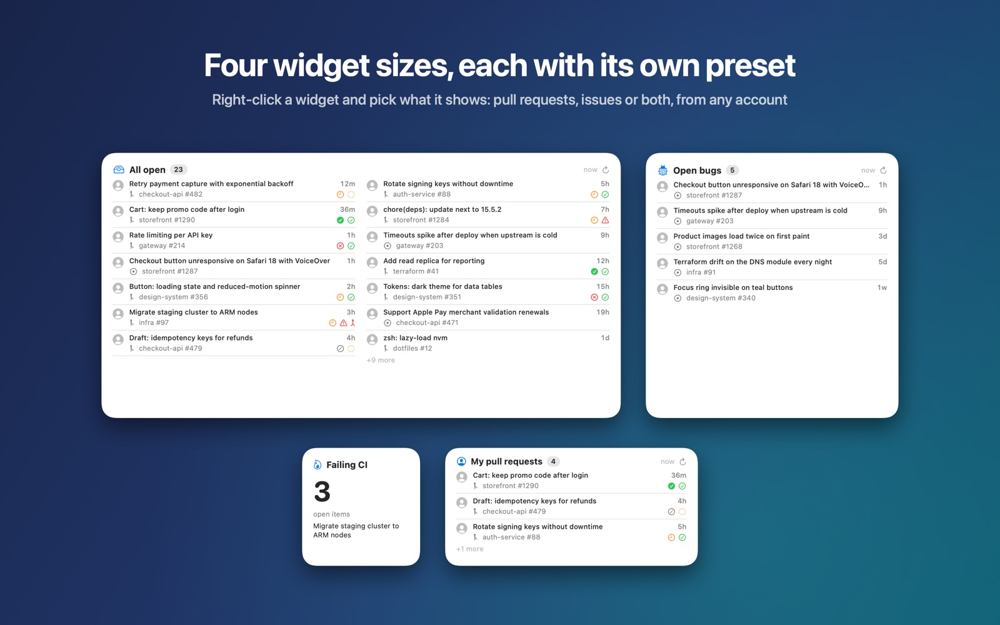
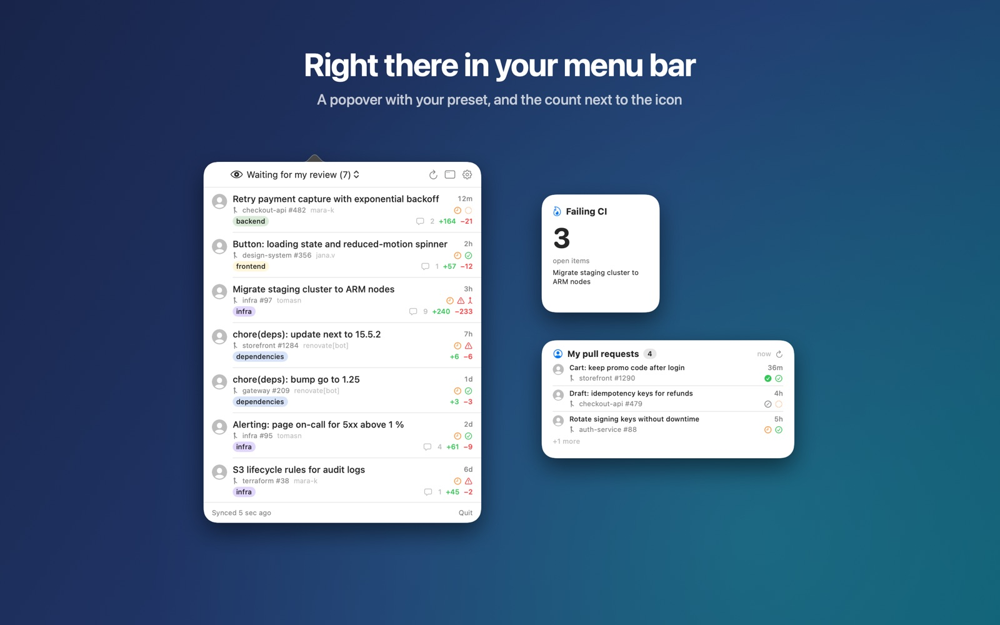
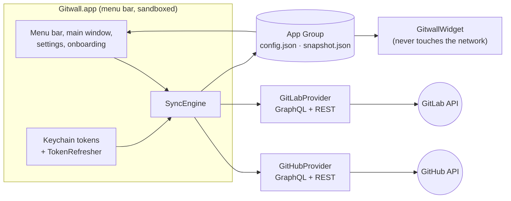

<p align="center">
  
</p>

<h1 align="center">Gitwall</h1>

<p align="center">
  Pull requests, merge requests and issues from GitHub and GitLab, in your Mac menu bar and on your desktop.
</p>

<p align="center">
  <a href="https://github.com/prokopsimek/gitwall/actions/workflows/ci.yml"></a>
  <a href="https://github.com/prokopsimek/gitwall/releases/latest"></a>
  
  
  <a href="LICENSE"></a>
</p>



Gitwall is a free, open-source macOS app for everyone who waits on code review or keeps an eye on a team's work.
It gathers open pull requests (merge requests on GitLab) and issues from the repositories you choose, sorts them
by latest activity and shows review, CI, draft and merge-conflict state at a glance. Click an item to open it in
the browser. There is no server: your Mac talks to GitHub and GitLab directly.

## Download

**[Download the latest release](https://github.com/prokopsimek/gitwall/releases/latest)**, unzip it and move
Gitwall.app to Applications. The build is signed with a Developer ID and notarized by Apple, so it opens without a
Gatekeeper warning. It does not update itself; the [Mac App Store version](https://apps.apple.com/app/gitwall/id6810724454?mt=12) does.

Requires macOS 14 Sonoma or later.

## Features

**Presets for every account, out of the box.** Each account you add comes with three presets: pull requests
assigned to you, issues assigned to you, and pull requests waiting for your review. Change their filters, delete
them or build your own from any mix of accounts, repositories, pull requests and issues.



**Filters that work the same on both platforms.** Relation to you (author, assignee, requested reviewer), drafts,
review state, checks, merge conflicts, labels, author logins, age, milestone and text. Each preset also decides
which events notify you.

Archived repositories never show up: nothing in them can be merged or closed, so Gitwall leaves them out of every
list and does not offer them when you pick repositories.

**What to do first.** Gitwall reads the *Priority* field of your GitHub Projects (P0–P3) and shows it as a small
capsule before the title. Sort a preset by *Priority* to get P0 at the top, the oldest item first within each level,
and everything without a priority at the end. Without a project field, a `p0`–`p3` label counts; on GitLab, labels are
the only source. An item in several projects takes its most urgent value. Reading projects needs one more scope, see
[GitHub and projects](#github-and-projects).

Pull requests that a cloud agent opened for you stay in "Waiting for my review" even though they are drafts:
Copilot and the Claude and Codex GitHub apps request the review before a person marks the pull request ready.
Filter the agents themselves with author logins such as `copilot-swe-agent` or `cursor`.



**A query field that speaks GitHub search syntax.** When the tick boxes run out, every preset has a *Query*
field. Gitwall reads it with GitHub's own rules and checks it against the items it already has, so it works for
GitLab too and the widget always agrees with the menu bar.

```
assignee:@me AND (assignee:franta-dxh OR assignee:lumir-sokol OR assignee:tomgilsky)
```

That one means *assigned to me **and** to at least one of the three*, and it finds the same items when pasted
into GitHub's issue search. A space works as `AND` too, `AND` binds tighter than `OR`, parentheses group up to five
levels deep, and a leading `-` excludes a term. Gitwall also reads a comma inside a qualifier as OR
(`assignee:franta-dxh,lumir-sokol`), but GitHub documents the comma only for `label:` and ignores it for `assignee:`,
so prefer `OR` when the query should work in both places.

| Qualifier | Matches |
|---|---|
| `assignee:` | anyone assigned |
| `author:` | who opened it |
| `label:` | a label |
| `milestone:` | the milestone |
| `reviewed-by:` | someone who reviewed it |
| `review-requested:` | someone whose review was requested |
| `involves:` | author, assignee or reviewer |
| `repo:` / `org:` | `acme/app` / `acme` |
| `is:` / `type:` | `pr`, `issue`, `draft`, `open` |
| `priority:` | `P0` to `P3`, from a project field or a label (GitHub Projects' syntax, not issue search) |
| a bare word | the title, the repository or `#number` |

`@me` is the account you signed in with; `assignee:@octocat` and `assignee:octocat` mean the same. Put values
with spaces in quotes: `milestone:"Q4 2026"`. A bare `@lumir-sokol` is an error, as on GitHub; write
`assignee:lumir-sokol`, or `"@lumir-sokol"` to search the text. There is no `NOT` and no minus in front of
parentheses. A query Gitwall cannot read matches nothing and says why, so a typo can never quietly widen a
preset.

Presets can also live outside Gitwall, as JSON in a repository of your own: see [Sharing presets](#sharing-presets).

**Issues too, not just pull requests.**



**Desktop widgets in four sizes.** Counter, List, Board and Wide Board. Add as many as you like; each widget shows
the preset you pick for it.



**Walls for a second monitor.** Window › Walls (⌘2) shows several presets side by side as tiles in the four widget
sizes, one tab per wall. Arrange them in the window (⌘E), zoom them for a large monitor and put the window full screen
on any display; the corner says how fresh the data is, in red when the last sync failed. Walls can rotate by themselves
and travel as JSON together with their presets, see [Sharing presets](#sharing-presets).

**Right there in your menu bar**, with the number of reviews waiting for you next to the icon.



**Detail next to the list.** Click an item in the main window or on a wall and Detail opens on the right, with what a
decision needs on the first screen:

- **Why it's here**: the terms of the preset's query the item matched (*Matches label:bug in “Bugs”*), and facts
  such as *Review requested from you*, *Checks are failing* or *Merge conflict*.
- **Next step**, one button with the exact link: *Review changes* opens the Files tab, *Reply to …* the comment
  itself, *Open failing check* that check's log, *Ready to merge* the pull request.
- **Latest word** of the other side, or *You replied last · 2h ago* when it is your turn to wait. A review counts
  without a text too (*Requested changes with 2 inline comments*); bots such as Codecov or Dependabot never do.
- **Status** of a pull request: reviewers and their verdicts, failing checks by name (the passed ones folded as
  *12 passed*), conflicts, size and the branch with a copy button.
- **What's new** since you last saw it here, with what arrives while you look marked as it comes in. An item counts
  as seen once its detail has loaded while it is on screen. The list marks items that changed since you saw them.

The description (Markdown, `<details>` folded), the conversation, the files and linked items are folded below.
Detail only reads: there is no approve or merge button, every action opens the item on GitHub. It asks GitHub for one
item when you open it, so the sync costs nothing more; see
[ADR 0015](docs/adr/0015-detail-is-read-only-and-fetched-on-demand.md). GitLab items show what the last sync knows and
a link, for now. The menu bar popover and the widgets still open the browser.

| Keys | In the main window (the Walls window below) |
|---|---|
| Click, ↑ ↓ | Select an item; Detail follows after a short pause |
| Space or ↩ | Show Detail |
| Esc | Close Detail |
| ⌥⌘I | Show or hide the Detail panel |
| Double-click, ⌘↩ | Open on GitHub or GitLab |
| ⌘C | Copy the link (Edit › Copy, while the list has the focus) |
| ⇧⌘C | Copy the reference, `owner/repo#123` |
| ⌥⌘C | Copy the branch name of a pull request |
| Item › Copy Link | Copy the link, also while you type in the search field |
| Item › Copy “gh pr checkout” Command | `gh pr checkout 123 -R owner/repo`, for GitHub pull requests (with the host on GitHub Enterprise) |
| ⌘F | Search the list; Esc goes back to the list |

And also:

- Sign in with GitHub or GitLab in one click, or paste a personal access token. OAuth tokens refresh in the
  background, so you sign in once.
- GitHub.com, GitHub Enterprise Server, GitLab.com and self-managed GitLab (16 or newer), several accounts at once.
- Local notifications for new items, review requests, approvals, requested changes, failed checks, merges and closes.
- A heads-up a week before a personal access token expires.
- Private by design: no analytics, no third-party services, credentials only in the macOS Keychain.
  See the [privacy policy](https://prokopsimek.github.io/gitwall/privacy/).

## Quick start

1. **Connect an account.** The first launch opens a short walkthrough. Choose *Sign in with GitHub* (you confirm a
   code at github.com) or *Sign in with GitLab*, or paste a personal access token. The account's three presets
   appear right away.
2. **Pick repositories.** Tick single repositories, or a whole GitHub organization or GitLab group so new
   repositories are picked up automatically.
3. **Add a widget.** Right-click the desktop › *Edit Widgets…* › search “Gitwall” › drag a size onto the desktop.
   Right-click the widget › *Edit “Gitwall”* › choose its preset.

### Supported hosts

| Host | Sign in | Or paste a token |
|---|---|---|
| github.com | OAuth device flow, built in | [Fine-grained or classic](#personal-access-tokens) |
| GitHub Enterprise Server | Your own OAuth App's client ID (Settings › Accounts › Advanced) | [Classic](#github-classic-token), or fine-grained where your server offers them |
| gitlab.com | OAuth with PKCE, built in | [Fine-grained or legacy](#personal-access-tokens) |
| Self-managed GitLab 16+ | Your own application's client ID, redirect `gitwall://oauth/gitlab` | [Legacy](#gitlab-legacy-token), or [fine-grained](#gitlab-fine-grained-token) on GitLab 19.2+ |

### Personal access tokens

Signing in is the quickest way. A token is the way to go when your organization blocks OAuth apps, when your own
server has no application for Gitwall, or when you want a credential that can only read. Paste it in
Settings › Accounts › + › *Use a personal access token instead*. Gitwall keeps it in the macOS Keychain and warns
you a week before it expires.

To move an account from a token to signing in, or back, use its menu in Settings › Accounts
(*Sign in with GitHub…*, *Use a Token Instead…*). The account keeps its repositories, presets and widgets. Removing
the account and adding it again does not: repositories and presets belong to the account, so a new one starts
empty. Add Account notices when you are already connected and offers to replace the sign-in instead.

| | Fine-grained token | Classic (GitHub) or legacy (GitLab) token |
|---|---|---|
| **GitHub** | Read-only. One token covers one owner: your account or one organization. Priorities only from projects of an organization. | Scopes `repo`, `read:org` and `read:project`. One token covers all your organizations, but `repo` also allows writing. |
| **GitLab** | Read-only, GitLab 19.2 or newer, but without each reviewer's review state. Needed where a group or the instance enforces fine-grained tokens. | Scope `read_api`, GitLab 16 or newer. |

#### GitHub fine-grained token

<details>
<summary>Recommended for github.com. Read-only, one owner per token.</summary>

1. Open the [prefilled token form](https://github.com/settings/personal-access-tokens/new?name=Gitwall&description=Read-only%20access%20for%20the%20Gitwall%20widgets&expires_in=365&pull_requests=read&issues=read&statuses=read&contents=read).
   It fills in the name, a one-year expiration and the permissions below. Without the link: Settings ›
   Developer settings › Personal access tokens › Fine-grained tokens › Generate new token.
2. **Resource owner:** your account, or the organization whose repositories you want to follow.
3. **Expiration:** at most 365 days. Organizations can set a shorter limit.
4. **Repository access:** *All repositories*, or *Only select repositories* (up to 50).
5. **Permissions › Repositories**, each set to *Read-only*:

   | Permission | Gitwall uses it for |
   |---|---|
   | Pull requests | pull requests, reviews and review requests; in Detail also comments, files and the timeline |
   | Issues | issues, labels, assignees and milestones; in Detail also comments and the timeline of issues |
   | Commit statuses | the CI state of pull requests, and in Detail the checks by name |
   | Contents | the CI state as well: without it GitHub hides the commit that carries the state |
   | Metadata | required by GitHub, added automatically |

   Account permissions are not needed. Contents also lets the token read your code. If you do not need the CI
   state, leave out Contents and Commit statuses; everything else keeps working.
6. **Permissions › Organization**, only when the resource owner is an organization: **Projects** › *Read-only*, for
   priorities from that organization's projects. The prefilled form does not set it, because it applies only to an
   organization owner.
7. Select **Generate token** and paste it into Gitwall.

Good to know:

- **One owner per token.** To follow your own repositories and two organizations, create three tokens and add
  three GitHub accounts in Gitwall. Each account gets its own presets. With a token owned by your account, the
  organization list in Gitwall stays empty; tick repositories instead.
- **Organization approval.** By default an organization owner has to approve a fine-grained token. Until then it
  reads only public repositories. Single sign-on (SAML) is handled while you create the token.
- **CI state without a Checks permission.** Fine-grained tokens cannot get *Checks*, but GitHub still reports
  the combined state of GitHub Actions and other checks when the token has Contents and Commit statuses.
- **Projects of your personal account.** GitHub documents fine-grained tokens for organization projects only; for
  priorities from projects of your own account, use a classic token.
</details>

#### GitHub classic token

<details>
<summary>One token for every organization. Also the choice for GitHub Enterprise Server.</summary>

1. Open the [prefilled token form](https://github.com/settings/tokens/new?scopes=repo,read:org,read:project&description=Gitwall).
   Without the link: Settings › Developer settings › Personal access tokens › Tokens (classic) › Generate new
   token (classic). On GitHub Enterprise Server, open the same page on your server.
2. **Scopes:** `repo` for private repositories, `read:org` for your organizations, `read:project` for priorities
   from GitHub Projects.
3. Pick an expiration, select **Generate token** and paste it into Gitwall.
4. For an organization with single sign-on (SAML): next to the token select **Configure SSO** › **Authorize**.
</details>

#### GitHub and projects

Priorities come from a single-select field named exactly **Priority** (GitHub compares the name with case) in an
open project, with the options `P0`–`P3`; `P1 - high` counts too, `High` does not. Reading it needs:

| How the account signs in | What to add |
|---|---|
| Sign in with GitHub | Nothing for new sign-ins. An account that signed in before this version: Settings › Accounts › … › *Sign in again…* and approve the new `read:project` scope. |
| Classic token | The scope `read:project`. You can add it to the existing token on GitHub (Settings › Developer settings › Tokens (classic) › the token › *Update token*); the token itself stays the same. |
| Fine-grained token | Organization permission *Projects: Read-only*, edited on the existing token. |

Without it, Gitwall keeps working with label priorities and says so under the account in Settings › Accounts. The
lookup is one extra request per 100 items and costs about one point of GitHub's hourly rate limit.

#### GitHub and Detail

Detail reads the same things the lists do, in more depth, and asks for no new scope or permission. A classic token
or a sign-in with `repo` reads all of it. With a fine-grained token, *Pull requests* and *Issues* cover the
description, comments, reviews, timeline and files; the checks by name come from *Commit statuses* and *Contents*.
Fine-grained tokens cannot get GitHub's *Checks* permission, and whether GitHub then lists check runs such as GitHub
Actions jobs by name for such a token has not been checked yet. When it does not, Detail says that the token may not
read the checks, links here, and shows everything else.

#### GitLab fine-grained token

<details>
<summary>GitLab 19.2 or newer, on gitlab.com and self-managed. Read-only.</summary>

1. Select your avatar › **Edit profile** › **Access** › **Personal access tokens** › **Generate token** ›
   **Fine-grained token**. Or open `/-/user_settings/personal_access_tokens/granular/new` on your server, for
   example [on gitlab.com](https://gitlab.com/-/user_settings/personal_access_tokens/granular/new).
2. Enter a name such as `Gitwall` and an **expiration date**. Fine-grained tokens always expire, by default
   within 365 days.
3. **Group and project access:** *All groups and projects that I'm a member of*, or only the ones you want to
   follow.
4. **Add resource permissions:** select each resource below and set its permission to **Read**.

   | Tab | Resource | Gitwall uses it for |
   |---|---|---|
   | Group and project | Projects › Project | the projects you follow |
   | Group and project | Groups › Group | the groups you follow |
   | Group and project | Repository › Merge Request | merge requests, approvals and reviewers |
   | Group and project | Project Planning › Work Item | issues and milestones |
   | Group and project | Project Planning › Label | labels |
   | Group and project | CI/CD › Pipeline | the pipeline state of merge requests |
   | User | System Access › User | your account, and authors, assignees and reviewers |
   | User | Projects › Project | the project list when you pick repositories |
   | User | Groups › Group | the group list when you pick repositories |
   | User | System Access › Personal Access Token | the expiry warning |

5. Select **Generate token** and paste it into Gitwall.

Good to know:

- **Review state.** GitLab does not give fine-grained tokens the review state of each reviewer. Gitwall then
  counts every reviewer who has not approved as still reviewing, so *Waiting for my review* can keep a merge
  request you already commented on, and *changes requested* does not show. A legacy token keeps the full state.
- **Missing permission.** GitLab answers with "Access denied: This operation requires a fine-grained personal
  access token with the following … permissions", naming the one to add.
</details>

#### GitLab legacy token

<details>
<summary>GitLab 16 or newer. Broad read access with a single scope.</summary>

1. Open the [prefilled token form on gitlab.com](https://gitlab.com/-/user_settings/personal_access_tokens?name=Gitwall&scopes=read_api),
   or the same path on your server. Without the link: avatar › **Edit profile** › **Access** › **Personal access
   tokens** › **Generate token** › **Legacy token**.
2. **Scope:** `read_api`.
3. Set an expiration date, select **Generate token** and paste it into Gitwall.

A group on gitlab.com can refuse legacy tokens after a date its owner sets, and an administrator can stop new
legacy tokens on a self-managed instance. Use a fine-grained token there.
</details>

## Sharing presets

Keep your presets as a JSON file wherever you like, for example in the repository of the team or the agents they
watch, and set them up in Gitwall by copy and paste. In **Settings › Presets › ⋯**:

- **Copy as JSON** copies the selected preset, **Copy All as JSON** every preset.
- **Paste Presets…** reads the clipboard, checks every preset, says how many are new and how many it replaces, and
  writes nothing until you confirm. From a terminal: `pbcopy < presets.json`.

```json
{
  "version": 1,
  "presets": [
    {
      "id": "6F0C2D6A-1B7E-4C55-9E0A-2D8E4B1F7A10",
      "name": "Waiting for me · agents",
      "query": "involves:franta-dxh (label:needs:approval OR (review-requested:@me -is:draft))",
      "icon": "hand.raised",
      "sort": "priority",
      "kinds": ["pullRequest", "issue"]
    }
  ]
}
```

| Key | Required | Value |
|---|---|---|
| `id` | yes | A UUID, for example from `uuidgen`. Pasting a preset whose id Gitwall already has replaces that preset instead of adding a second one. |
| `name` | yes | Not blank. |
| `query` | yes | What the *Query* field takes (see [Features](#features)); it must parse. `""` shows every item. |
| `icon` | no | An SF Symbol name. Default `tray.full`. |
| `sort` | no | `lastActivity` (default), `newestCreated`, `oldestCreated` or `priority`. |
| `kinds` | no | `pullRequest`, `issue` or both (default). |

A bare list `[ … ]` of presets works too. With the wrapper, `version` must be `1`.

- **Strict.** An unknown key, a query Gitwall cannot read, an id that is not a UUID or appears twice, an unknown
  icon, sort or kind: the paste stops, says which preset (counted from 1) and why, and changes nothing.
- **Nothing is deleted.** Presets that are not in the paste stay as they are.
- **A replaced preset keeps what is set on this Mac**: its accounts and repositories, notifications and the menu bar
  count. Its other filters (relation to me, drafts, review, labels and the rest) give way to the pasted query, which
  defines a preset from a file on its own. Put the conditions in the query: `repo:`, `org:`, `assignee:`, `label:` ….
- **Copy writes every key**, so copying and pasting back gives exactly the same presets and the same text. When a
  copied preset is narrowed to accounts or uses filters outside its query, Gitwall copies it anyway and tells you
  what was left out.

The format is versioned and will not change under the same version; see
[ADR 0013](docs/adr/0013-presets-travel-as-json-with-stable-ids.md).

### Walls in the same file

Walls travel with the presets they show, in one file with `"version": 2`, so a whole setup pastes in one step. **Edit ›
Paste Configuration…** (⇧⌘V) and **Paste Presets…** take it; **Copy Wall as JSON** (the context menu of a wall's tab,
or the Wall menu) writes a wall together with every preset its tiles use, so it pastes into another Gitwall as it is.
**Edit › Copy Configuration as JSON** writes every preset and every wall, the whole setup of one Mac for another.

```json
{
  "version": 2,
  "presets": [
    { "id": "6F0C2D6A-1B7E-4C55-9E0A-2D8E4B1F7A10", "name": "Waiting for me · agents", "query": "involves:franta-dxh" }
  ],
  "walls": [
    {
      "id": "3C1F6A70-5D2B-4E8A-9B47-0F2C6D8E1A35",
      "name": "Waiting for me",
      "tiles": [
        { "preset": "6F0C2D6A-1B7E-4C55-9E0A-2D8E4B1F7A10", "size": "large" }
      ]
    }
  ]
}
```

| Key | Required | Value |
|---|---|---|
| `presets` | no | Presets as above. At least one of `presets` and `walls` holds something. |
| `walls` | no | Each with an `id` (a UUID), a `name` and `tiles`. |
| tile `preset` | yes | The id of a preset in the same file or already in Gitwall. |
| tile `size` | no | `small` (1 row), `medium` (3, default), `large` (7) or `extraLarge` (14, two columns), like the widgets. Gitwall always writes it. |

The same rules hold as for presets: everything is checked first and the error names the wall, the tile and the
reason; a wall whose id Gitwall has is replaced whole, a new one is added, and nothing is deleted. A preset that a tile
shows can be deleted; the tile then says so and waits to be removed. Version 1 files paste exactly as before. Zoom,
rotation and the selected wall stay on your Mac. See [ADR 0014](docs/adr/0014-walls-travel-with-presets-in-one-file.md).

### The Walls window

Every command is in the **Wall**, **View** and **Item** menus too. Detail of the selected item opens on the right,
explained by the preset of the tile that holds it; a dot marks items new since the last sync or changed since you
saw them.

| Keys | Does |
|---|---|
| ⌘2 | Open the Walls window |
| ⌘⇧] / ⌘⇧[ or ⌃⇥ / ⌃⇧⇥ | Next / previous wall |
| ⇥ / ⇧⇥ | Next / previous tile |
| ↓ / ↑ | Next / previous item in the tile |
| ↩ or Space, a click | Show Detail of the item |
| Esc | Close Detail (while editing, finish editing) |
| ⌥⌘I | Show or hide the Detail panel |
| ⌘↩, a double click | Open the item in the browser |
| ⌘C | Copy the item's link |
| ⌘E | Edit the wall: drag tiles, add them from the presets above, remove them |
| 1–4 (while editing) | Size of the selected tile: small, medium, large, extra large |
| Delete (while editing) | Remove the selected tile |
| ⌘Z / ⇧⌘Z | Undo / redo a change to a wall |
| ⌘+ / ⌘− / ⌘0 | Zoom in / out / actual size, remembered for the window |
| ⌃⌘F | Full screen, on whichever display the window is. The tiles grow to fill the screen, beside Detail when it is open; ⌘+ and ⌘− zoom from there and ⌘0 (View › Fit to Screen) fits the wall again |

A double click on a tab renames it; its context menu also duplicates, copies and deletes the wall. A click on a tile's
title opens that preset in the main window. **View › Rotate Walls** switches walls by itself every 30 seconds to
5 minutes (View › Rotation Interval) and waits two minutes after you use the keyboard or the mouse in the window.

## Development

You need Xcode 26 and [XcodeGen](https://github.com/yonaskolb/XcodeGen).

```sh
brew install xcodegen
git clone https://github.com/prokopsimek/gitwall.git && cd gitwall
make run          # generates the project, builds Debug and launches it
```

| Command | What it does |
|---|---|
| `make run` | Debug build and launch |
| `make test` | `swift test` for every package, then the app tests |
| `make test-packages` | Package tests only (fast, no Xcode UI) |
| `make install` | Release build into `~/Applications`, for daily use |
| `make screenshots` | App Store and README screenshots from built-in demo data |
| `make archive` / `make release` | App Store archive / notarized download (see [RELEASING](docs/RELEASING.md)) |

`project.yml` is the source of truth; the generated `Gitwall.xcodeproj` is not committed.

### How it fits together



The app fetches and writes a snapshot into the App Group; widgets only read it and apply their preset with the
same `FilterEngine` the app uses, so both always agree.

| Where | What lives there |
|---|---|
| [`Packages/`](Packages/AGENTS.md) | All logic, test-first: models, filters, sync, providers, OAuth |
| [`Gitwall/`](Gitwall/AGENTS.md) | App target: windows, menu bar, settings, onboarding |
| [`GitwallWidget/`](GitwallWidget/AGENTS.md) | The four widgets (and why their kinds must never be renamed) |
| [`Scripts/`](Scripts/AGENTS.md) | App Store Connect client, screenshot pipeline, icon rendering |
| [`docs/adr/`](docs/adr) | Why things are the way they are |

### Handy launch arguments (Debug builds)

| Argument | Use it for |
|---|---|
| `--debug-fresh` | A throwaway container and in-memory Keychain: try onboarding or sign-in without touching your real accounts |
| `--debug-demo` | Fictional accounts and items, no network; add `--debug-demo-widgets` to see all widget sizes, or `--debug-demo-walls [window\|edit\|empty\|fullscreen]` for the Walls window alone |
| `--debug-onboarding-step <step>` | Jump straight to one walkthrough screen |
| `--debug-github-token <pat> --debug-repos a/b` | Create a GitHub account without clicking |
| `--debug-detail owner/repo#123` | Open Detail of that item in the main window; add `--debug-detail-expand description,conversation` to unfold sections |

```sh
build/DerivedData/Build/Products/Debug/Gitwall.app/Contents/MacOS/Gitwall --debug-fresh
```

### Tests

Logic is developed test-first with Swift Testing, against fixtures captured from the real APIs. Tests that need a
live server or a human are skipped unless you opt in:

```sh
GITWALL_GITHUB_TOKEN=github_pat_… GITWALL_GITHUB_REPO=owner/private-repo \
  swift test --package-path Packages/GitwallGitHub --filter Integration
GITWALL_GITLAB_TOKEN=glpat-… GITWALL_GITLAB_URL=https://gitlab.example.com \
  swift test --package-path Packages/GitwallGitLab --filter Integration
GITWALL_OAUTH_INTERACTIVE=1 swift test --package-path Packages/GitwallAuth --filter Interactive
GITWALL_GITHUB_TOKEN=github_pat_… GITWALL_GITHUB_DETAIL=owner/repo#123 \
  swift test --package-path Packages/GitwallGitHub --filter ItemDetailIntegration
```

Run the provider suites with both a classic and a fine-grained token when you touch the queries: fine-grained
tokens only reach what their permissions list, so a new field can work with one and fail with the other.

## Contributing

Issues and pull requests are welcome. A few house rules, spelled out in [AGENTS.md](AGENTS.md):

- Logic goes into a package with a test first; the app and widget targets stay thin.
- Provider-specific types never reach the UI; add a capability instead of `if kind == .github`.
- Never commit tokens or keys. OAuth client IDs in `OAuthClients.swift` are public by design.
- Commit messages follow [Conventional Commits](https://www.conventionalcommits.org).

## License

MIT, see [LICENSE](LICENSE). Made by [Prokop Simek](https://github.com/prokopsimek).
